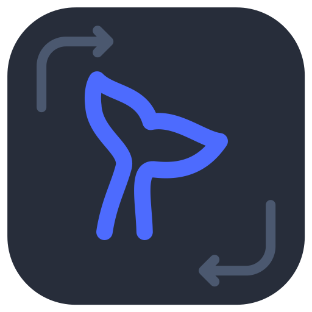
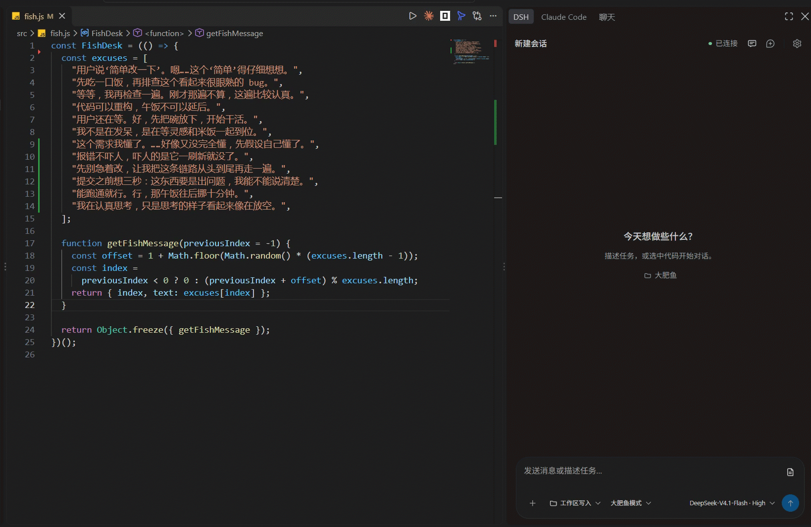
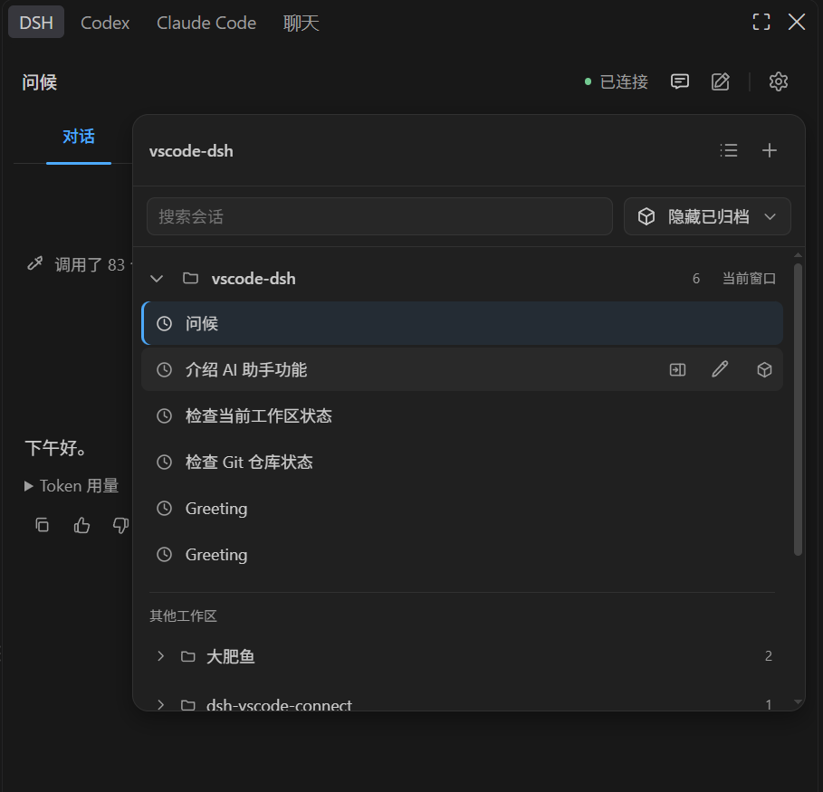

<p align="center">
  
</p>

<h1 align="center">DSH Coding Agent</h1>

<p align="center"><strong>Use DeepSeek Harness in VS Code</strong></p>

<p align="center">
  <a href="https://github.com/mcdottok/vscode-dsh/releases">Download VSIX</a> ·
  <a href="#demos">Demos</a> ·
  <a href="#install-the-extension">Install</a> ·
  <a href="#connect-to-dsh">Connect</a> ·
  <a href="README.md">简体中文</a>
</p>

DSH Coding Agent is a community-maintained VS Code extension. Ask questions about your project, follow tool execution, and review changes in the editor. Continue the same session in VS Code and [DeepSeek Harness Desktop](https://github.com/deepseek-ai/deepseek-harness), with updates synced in real time.

## Features

| Feature                | What you can do                                                                                                                                      |
| ---------------------- | ---------------------------------------------------------------------------------------------------------------------------------------------------- |
| Resume sessions        | Continue the same session across VS Code and DSH Desktop in real time while reviewing code.                                                          |
| Editor context         | Attach code selections, files, and images so DSH can see what you are discussing.                                                                    |
| Tools and approvals    | Follow replies, reasoning, and tool progress as they stream, respond to questions and approvals, and review code changes.                            |
| Models and permissions | Choose the models and permissions provided by the connected DSH runtime. In a root session that supports Agent Teams, toggle it from the model menu. |

See [runtime compatibility](docs/dsh-contract.md) and the [capability matrix](docs/capability-matrix.md) for supported behavior.

## Demos

### Sync a session between VS Code and DSH Desktop

Connect to DSH Desktop and open the same workspace and existing session in both apps to continue the conversation in either one.


### Ask with code context

Select code in the editor, attach it to your message, and ask about it in the DSH sidebar.



### Find and resume sessions

Browse and search existing sessions by workspace, then return to a conversation to continue working on your project.



## Install the extension

The extension is temporarily delisted from the VS Code Marketplace. Install it from GitHub Releases.

1. Download the `.vsix` from [GitHub Releases](https://github.com/mcdottok/vscode-dsh/releases).
2. In the VS Code Extensions view, open the **…** menu, choose **Install from VSIX…**, and select the downloaded file.
3. Open and trust your project folder, then expand **DSH** in the right sidebar.

## Connect to DSH

The extension supports two connection modes. Open **Settings → Connection** in the DSH panel and choose the one that suits your workflow.

- **DSH Desktop — shared sessions**. Connect to a running Desktop instance and continue the same session in VS Code and DSH Desktop. Install and enable the `dsh-vscode-connect` plugin in Desktop.
- **DSH CLI — independent service**. The extension uses the locally installed DSH CLI to start a separate service. You can work directly in VS Code without opening Desktop or installing the connector plugin.

#### Option 1 · Connect to DSH Desktop

1. Install and enable [dsh-vscode-connect](https://github.com/mcdottok/dsh-vscode-connect) by **mcdottok** from the Desktop plugin marketplace. You can also enter `dsh-vscode-connect@latest` via **Plugins → Add plugin**.
2. Keep Desktop running. In VS Code, select **DSH Desktop** and choose **Connect to Desktop**. On the same Windows PC, the extension attempts to discover and connect to Desktop automatically. On other platforms, enter the connection address manually the first time.

**To connect manually**, open **Settings → General → VS Code connection** in Desktop. This entry is enabled by default. If you previously disabled it, turn it back on. Copy the address, run **DSH: Connect to Desktop** from the VS Code Command Palette, and paste the address.

A saved manual address takes precedence. VS Code SecretStorage keeps your credentials. On the same Windows PC, the extension attempts to reconnect after an interruption and prompts for an updated address if recovery fails.

#### Option 2 · Use DSH CLI

1. Install Node.js. See [runtime compatibility](docs/dsh-contract.md) for version requirements.
2. Select **DSH CLI** in the connection settings. The extension detects the installed CLI, or you can select the executable manually.
3. Choose **Start and connect**.

**If the CLI is missing**, choose **Install in Terminal** and press Enter to run the install command. Once it finishes, choose **Recheck DSH**, then start the connection. The extension installs the npm `latest` version by default. To use a specific version, select it under **DSH CLI installation and version**.

You can also install the CLI directly in a terminal:

```sh
npm install --global @deepseek-ai/dsh
```

**Using the CLI in Remote WSL**

1. Install DSH Coding Agent in your VS Code WSL window and install Node.js and the DSH CLI in the same Linux distribution. In the integrated terminal, run `node -p process.platform` and `dsh --version` to confirm the platform is `linux` and the CLI reports a version.
2. In the DSH panel, choose **DSH CLI → Recheck DSH → Start and connect**. The extension checks the default `nvm` environment in WSL first and then other locations on the Linux `PATH`. If it still cannot find the CLI, run `command -v dsh` in the WSL terminal and put its output in `dsh.runtime.executablePath` under the **Remote [WSL]** settings. Installing a version from the list uses the same Linux npm that retrieved the list.

**Using the CLI in Remote SSH**

1. Install Microsoft's **Remote - SSH** extension in your local VS Code. Run **Remote-SSH: Connect to Host...** to connect to a Linux host, then open and trust the remote project folder. The first connection may take a moment while VS Code Server installs. See the [VS Code connection guide](https://code.visualstudio.com/docs/remote/ssh#connect-to-a-remote-host).
2. In the SSH window, install **DSH Coding Agent** from the VSIX and confirm it appears under **SSH: hostname** in the Extensions view.
3. Run `node --version` in the SSH window's integrated terminal. Install Node.js on the host if needed, then install the DSH CLI using the npm command above. Run `dsh --version` to verify the CLI is available.
4. In the DSH panel, select **DSH CLI** and choose **Start and connect**. If the extension cannot find the CLI, run `command -v dsh` in the SSH window's terminal. If it returns an executable path, enter it as `dsh.runtime.executablePath` under **Remote [SSH: hostname]** in VS Code Settings. Choose **Recheck DSH** and retry the connection.

## Development and feedback

- For local development, see the [build instructions](BUILD.md), [contribution guide](CONTRIBUTING.md), and [developer documentation](docs/README.md).
- To report a problem, open an [issue](https://github.com/mcdottok/vscode-dsh/issues) with your connection mode and steps to reproduce it.
- See the [changelog](CHANGELOG.md) and [roadmap](ROADMAP.md) for release history and planned work.

## License and credits

The community independently maintains this extension under the [MIT license](LICENSE).

Thanks to the following open-source projects.

| Project                                                                                 | Contribution                                  |
| --------------------------------------------------------------------------------------- | --------------------------------------------- |
| [Jabofish/deepseek-harness-vscode](https://github.com/Jabofish/deepseek-harness-vscode) | Early implementation of the VS Code extension |
| [DeepSeek Harness](https://github.com/deepseek-ai/deepseek-harness)                     | The DSH runtime the extension connects to     |
