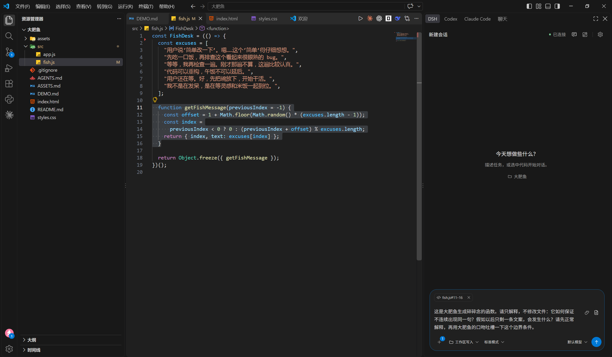
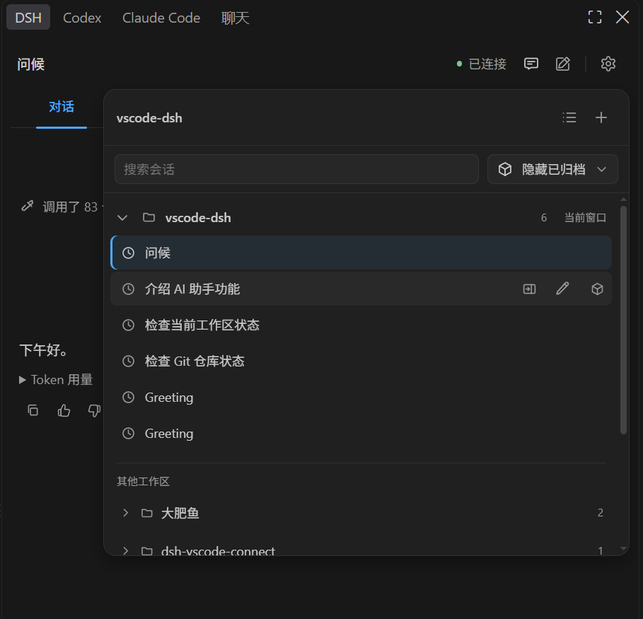
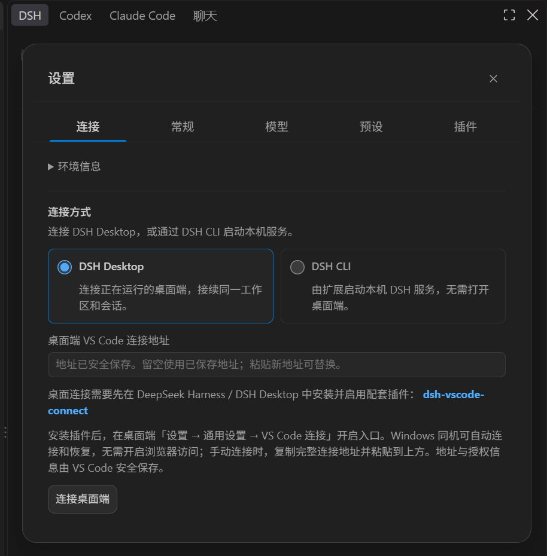
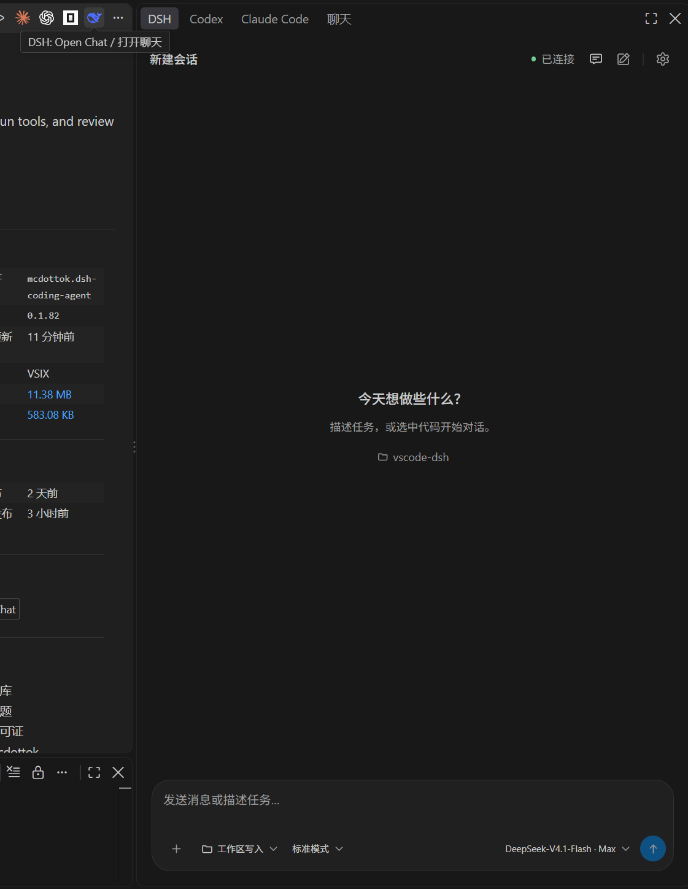

# DSH Coding Agent

[简体中文](README.md) | English

Develop with DeepSeek Harness in VS Code, with an editor workflow similar to Codex and Claude Code extensions: chat about your project, attach selections and files, follow tool execution, and review changes. Run DSH CLI locally or connect to Desktop and continue the same workspace and session.

## Install and connect

Install **DSH Coding Agent** in VS Code, open a trusted project folder, then open **DSH** in the right side bar. Choose either way to run DSH below.

### Option 1: Connect to Desktop and continue shared sessions

1. In the DeepSeek Harness / DSH Desktop **plugin marketplace**, search for **dsh-vscode-connect** by **mcdottok**, then install and enable it. Alternatively, open **Plugins → Add plugin** and enter `dsh-vscode-connect@latest`. Its **VS Code connection** entry is on by default for new installations. See [dsh-vscode-connect](https://github.com/mcdottok/dsh-vscode-connect) for details.
2. Keep Desktop running. On Windows, the plugins discover and connect automatically on the same machine, without copying an address or enabling browser access.
3. Select the same workspace and existing session to continue from either app.

If you previously disabled the connection entry, re-enable **Settings → General → VS Code connection** in Desktop. A saved manual connection takes precedence. On local Windows, interrupted Desktop connections automatically refresh their address and authorization before reconnecting. A saved address without pairing information can recover only when a unique local Desktop is verified. Manual recovery steps appear if automatic recovery fails.

For other platforms, remote environments, or when automatic connection is unavailable, copy the address from Desktop's **VS Code connection** entry and run **DSH: Connect to Desktop** in VS Code. Credentials are stored in VS Code SecretStorage.

### Option 2: Use DSH CLI

This option requires neither Desktop nor the connect plugin. Install Node.js (see [compatibility](docs/dsh-contract.md) for runtime requirements and supported DSH versions), then run:

```sh
npm install --global @deepseek-ai/dsh
```

In the extension, open **Settings → Connection source**, select **DSH CLI**, confirm the detected DSH CLI installation or select an executable, then click **Start and connect**. You can also install a specific version under **DSH CLI installation and version** in settings. The extension starts a separate service; use option 1 to continue an existing Desktop session.

If you download a `.vsix` from GitHub Releases, install it with **Extensions: Install from VSIX...** in VS Code.

## In your editor

- Continue shared sessions with streaming replies, thinking and tool progress.
- Attach selected code, images and files; respond to questions and approvals.
- Choose the models and permissions offered by DSH, and inspect proposed changes.
- Chat in the side bar or an editor tab.

The extension attaches to your running DSH by default. Advanced features depend on the connected runtime; see [compatibility](docs/dsh-contract.md) and the [capability matrix](docs/capability-matrix.md).

## Development

See [build instructions](BUILD.md), [contributing](CONTRIBUTING.md) and [developer documentation](docs/README.md). This community build uses `mcdottok.dsh-coding-agent`. Earlier manually installed `mcdottok.vscode-dsh` and `dsh-local.vscode-dsh` builds are separate extensions: uninstall them before installing the new build. You may need to configure the connection again.

See the [changelog](CHANGELOG.md) for this fork’s development history and version changes.

## Feature preview

### Ask about selected code

Select code in the editor and attach it as context to discuss the implementation directly in the side bar.



### Find and resume sessions

Browse and search existing sessions by workspace, then return to a conversation to continue working on your project.



### Choose how to connect

Connect to **DSH Desktop** to continue Desktop sessions, or select **DSH CLI** to let the extension start a local service.



### Start a conversation in the editor

Click the **DSH** icon in the editor title bar to open chat, choose a model and permissions, and describe your task.



[Download the full demo video (MP4, about 24 MB)](https://github.com/mcdottok/vscode-dsh/raw/refs/heads/main/docs/assets/demo.mp4)

## License and credits

MIT. Based on [Jabofish/deepseek-harness-vscode](https://github.com/Jabofish/deepseek-harness-vscode). Powered by [DeepSeek Harness](https://github.com/deepseek-ai/deepseek-harness). This is an independent community project.
