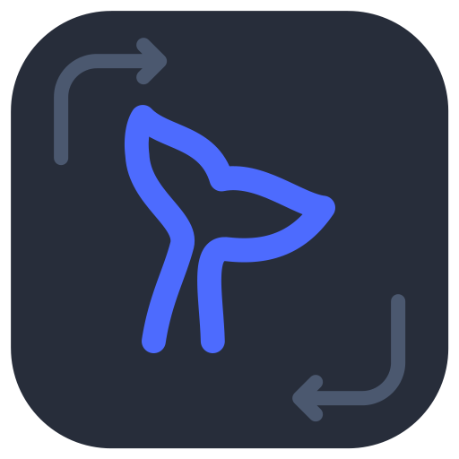
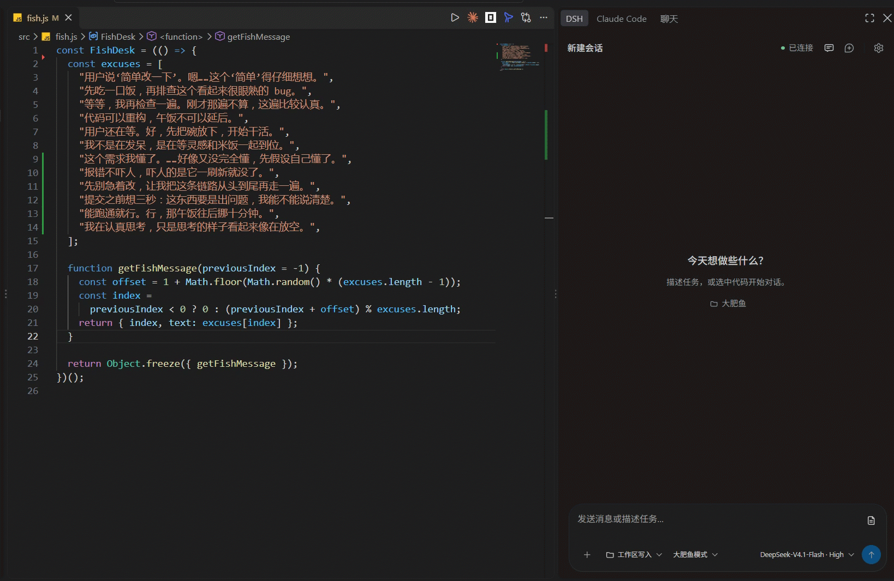
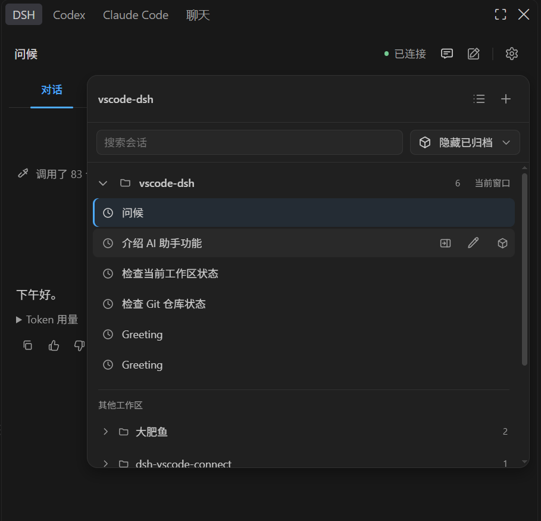

<p align="center">
  
</p>

<h1 align="center">DSH Coding Agent</h1>

<p align="center"><strong>在 VS Code 中使用 DeepSeek Harness</strong></p>

<p align="center">
  <a href="https://github.com/mcdottok/vscode-dsh/releases">下载 VSIX</a> ·
  <a href="#功能演示">功能演示</a> ·
  <a href="#安装扩展">安装</a> ·
  <a href="#连接-dsh">连接</a> ·
  <a href="README.en.md">English</a>
</p>

DSH Coding Agent 是一款社区维护的 VS Code 扩展。你可以在编辑器里围绕当前项目提问、跟踪工具执行并审阅变更，支持在 VS Code 和 [DeepSeek Harness Desktop](https://github.com/deepseek-ai/deepseek-harness) 之间接续同一个会话， 双端实时同步。

## 核心功能

| 功能         | 用法                                                         |
| ------------ | ------------------------------------------------------------ |
| 会话接续     | 在 vscode 和 DSH 中实时续接同一会话，方便阅览代码。          |
| 编辑器上下文 | 附加代码选区、文件和图片，让 DSH 看见你正在讨论的内容。      |
| 工具与审批   | 实时查看回复、思考和工具进度，处理提问与审批，审阅代码变更。 |
| 模型与权限   | 在对话中选择当前 DSH 运行时提供的模型和权限。                |

运行时支持范围见[兼容说明](docs/dsh-contract.md)和[能力矩阵](docs/capability-matrix.md)。

## 功能演示

### VS Code 与 DSH Desktop 双端同步

连接 DSH Desktop 后，在两端打开同一个工作区和已有会话，即可切换到另一端继续对话。


### 结合代码上下文提问

选中编辑器中的代码，将选区附加到消息，在 DSH 侧栏中直接提问。



### 查找和接续会话

按工作区浏览和搜索已有会话，快速回到之前的对话，继续当前项目的开发。



## 安装扩展

目前请通过 GitHub Releases 安装。扩展暂时从 VS Code 商城下架。

1. 从 [GitHub Releases](https://github.com/mcdottok/vscode-dsh/releases) 下载 `.vsix`。
2. 在 VS Code 中打开扩展视图，在 **…** 菜单中选择 **从 VSIX 安装…**，打开下载的文件。
3. 打开并信任项目文件夹，在右侧展开 **DSH**。

## 连接 DSH

扩展支持两种连接方式。在 DSH 面板中打开 **设置 → 连接**，按你的使用场景选择。

- **DSH Desktop｜双端同步**：连接正在运行的桌面端，在 VS Code 和 DSH Desktop 之间接续同一个会话。需要在桌面端安装并启用 `dsh-vscode-connect`。
- **DSH CLI｜独立运行**：由扩展使用本机安装的 DSH CLI 启动独立服务。适合直接在 VS Code 中开始开发，无需打开桌面端或安装连接插件。

#### 方式一：连接 DSH Desktop

1. 在桌面端的插件市场安装并启用 [dsh-vscode-connect](https://github.com/mcdottok/dsh-vscode-connect)（作者 **mcdottok**）。也可以打开 **插件 → 添加插件**，输入 `dsh-vscode-connect@latest`。
2. 保持桌面端运行。在 VS Code 中选择 **DSH Desktop**，点击 **连接桌面端**，在 Windows 平台扩展会尝试自动发现桌面端并连接， 其他平台需首次手动填写连接地址。

**需要手动连接时**，打开桌面端的 **设置 → 通用设置 → VS Code 连接**。该入口默认开启，曾关闭的话先重新开启。复制连接地址，在 VS Code 命令面板运行 **DSH: Connect to Desktop / 连接桌面端**，然后粘贴地址。

已保存的手动地址优先使用，凭据由 VS Code SecretStorage 保存。Windows 同机连接中断时，扩展会尝试重连，失败后会提示更新地址。

#### 方式二：使用 DSH CLI

1. 安装 Node.js，版本要求见[兼容说明](docs/dsh-contract.md)。
2. 在连接设置中选择 **DSH CLI**。扩展会检测已安装的 CLI，也可以手动选择可执行文件。
3. 点击 **启动并连接**。

**尚未安装 CLI 时**，点击 **在终端中安装**，按 Enter 执行安装命令。完成后点击 **重新检测 DSH**，再启动连接。默认安装 npm 的 `latest` 版本，也可以在 **DSH CLI 安装与版本** 中选择指定版本。

也可以直接在终端安装：

```sh
npm install --global @deepseek-ai/dsh
```

## 开发与反馈

- 本地开发见[构建说明](BUILD.md)、[贡献指南](CONTRIBUTING.md)和[开发者文档](docs/README.md)。
- 反馈问题请提交 [Issue](https://github.com/mcdottok/vscode-dsh/issues)，附上使用的连接方式和复现步骤。
- 版本变更与后续计划见[更新日志](CHANGELOG.md)和[路线图](ROADMAP.md)。

## 许可与致谢

本扩展由社区独立维护，采用 [MIT 许可证](LICENSE)。

感谢以下开源项目：

| 项目                                                                                    | 贡献                    |
| --------------------------------------------------------------------------------------- | ----------------------- |
| [Jabofish/deepseek-harness-vscode](https://github.com/Jabofish/deepseek-harness-vscode) | 早期的 VS Code 扩展实现 |
| [DeepSeek Harness](https://github.com/deepseek-ai/deepseek-harness)                     | 扩展连接的 DSH 运行时   |
